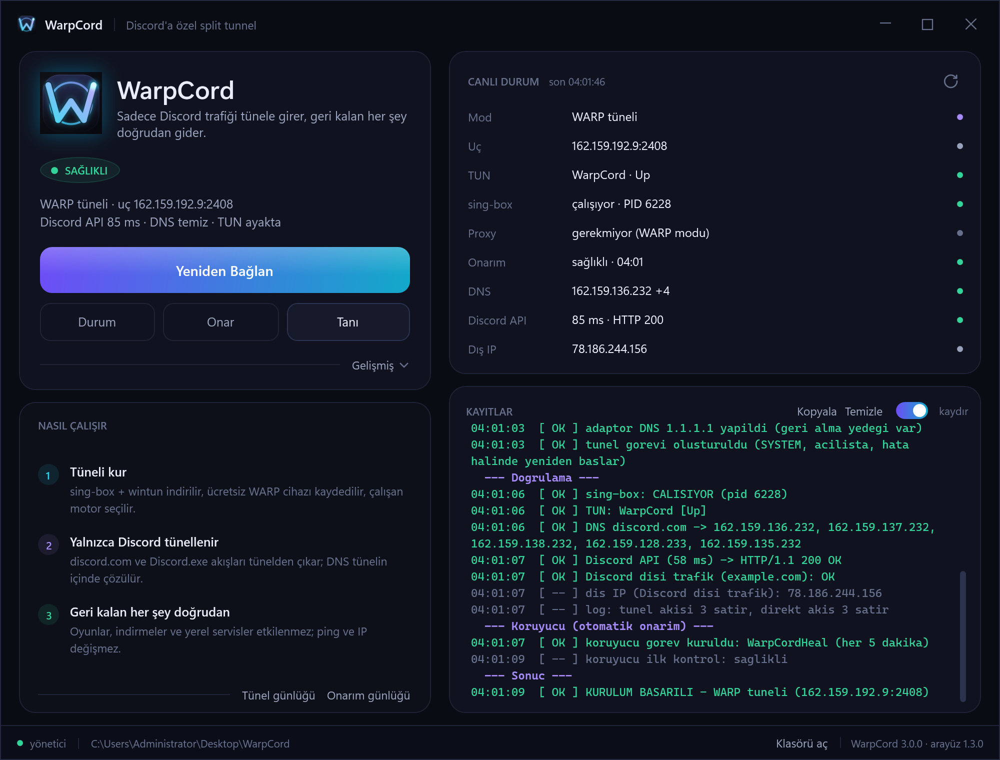
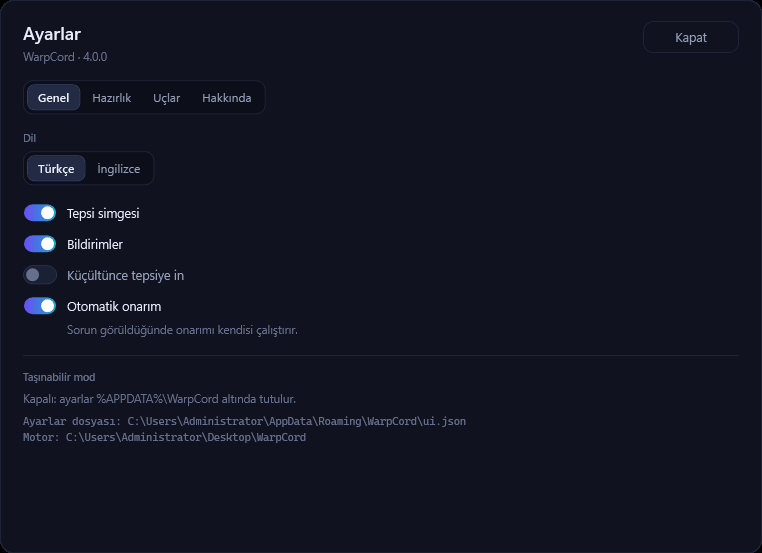
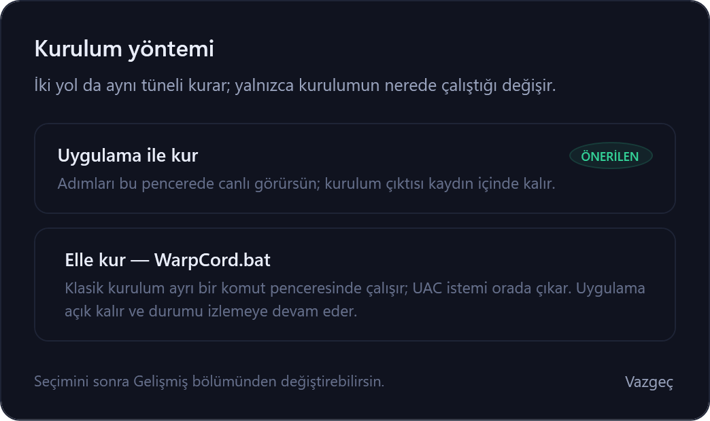

**[Türkçe](README.tr.md)** | English &nbsp; [](https://github.com/Edipcm-hash/warpcord/actions/workflows/build.yml)

# WarpCord

A Discord-only split tunnel: **only Discord traffic** leaves through the tunnel, everything else keeps going direct. No VPS, no account, no routing your whole machine through a VPN.

Windows 10/11 (64-bit), admin rights and internet are enough. **No Python, no .NET SDK.**

## Quick start

1. Extract the archive anywhere (Desktop is fine).
2. Double-click **`WarpCord.bat`** and accept the UAC prompt. (Or use `dist\WarpCord.exe` for the same work in one window.)
3. Wait: sing-box + `wintun.dll` download, a free WARP device is registered, endpoints are probed, the working engine is picked.
4. Fully quit Discord (tray icon too) and start it again.

| Check | Repair | Uninstall | Diagnose |
|---|---|---|---|
| `durum.bat` | `onar.bat` | `kaldir.bat` | `tani.bat` |

## Desktop app

`dist\WarpCord.exe` — one file (~541 KB) with the engine inside; install, repair and status in a single window.



- **Live status:** mode, endpoint, TUN, processes, last repair, DNS, Discord API latency (mini graph), voice (UDP) probe, traffic counter, public IP.
- **One button:** *Kur ve Bağlan* when absent, *Onar* when broken, *Yeniden Bağlan* when healthy.
- **Tray icon:** status colour plus a notification when the tunnel drops; minimises to the tray.
- **Log tabs:** Action / Tunnel (`tunnel.log`) / Repair (`heal.log`), live.
- **Settings window:** language (Turkish/English), tray and notifications, automatic repair, **Readiness** check (SAC/WDAC/Defender/policy), **Endpoints** comparison, update check and diagnostics bundle.
- **Restart Discord** (status bar): the "fully quit and reopen" step after an install, in one click.
- **Network changed banner:** after Wi-Fi → cable it offers to refresh DNS.
- **Install on this machine:** Settings → Install; adds a Start menu shortcut, no admin needed (portable use keeps working).
- **Elevation:** the window opens unelevated and escalates through UAC only for actions.
- **Standalone:** copying `WarpCord.exe` on its own works; the engine is unpacked to `%LOCALAPPDATA%\WarpCord\engine\<version>\` on first use. Drop a `portable.txt` next to it to keep settings and the engine beside the exe.



Language: **gear → Settings → Language** (Turkish / English). Applied immediately and remembered — [screenshot](docs/ui-language.png).

### Two install routes

On a machine without WarpCord the app asks once and remembers; change it later under **Gelişmiş → Kurulum yöntemi**:



- **Uygulama ile:** the install runs in this window, steps stream live.
- **Elle (WarpCord.bat):** the classic installer opens in its own elevated console; the window keeps watching.

The classic route stays for anyone who never opens the GUI: `WarpCord.bat`, `durum.bat`, `onar.bat`, `kaldir.bat`, `tani.bat`.

### Building

The C# compiler that ships with Windows is enough (signing and SAC notes: [docs/SIGNING.md](docs/SIGNING.md)):

```bat
gui\build.ps1                    :: dist\WarpCord.exe
gui\build.ps1 -Shortcut -Smoke   :: desktop shortcut + smoke test
```

Other states: [problem](docs/ui-broken.png) · [not installed](docs/ui-empty.png) · [DPI engine](docs/ui-dpi.png) · [advanced panel](docs/ui-advanced.png) · [manual install](docs/ui-manual.png) · [single file](docs/ui-standalone.png) · [SAC warning](docs/ui-sac.png) · [English UI](docs/ui-en.png)

## Two engines

Discord is blocked in Turkey by DNS poisoning + SNI filtering. WarpCord knows both ways out and picks what works:

| Mode | When | IP hidden | Voice |
|---|---|---|---|
| `warp` | Cloudflare WARP works on the line | Yes | Yes (UDP tunnelled) |
| `dpi` | WARP itself is blocked (Superonline) | No | Usually yes |

`dpi` splits the TLS ClientHello across several TLS records (RFC 8446 allows it); DPI cannot see "discord.com" in a single record. No driver needed, scoped to Discord only — a single-file GoodbyeDPI/zapret.

## How it works

```
Discord.exe, *.discord.com → TUN (WarpCord) → sing-box → warp | frag | direct
```

- **sing-box** opens a TUN device; traffic whose domain belongs to Discord **or** whose process is Discord goes to the tunnel/proxy, everything else to `direct`.
- **DNS** is answered inside sing-box over DoH (1.1.1.1); the ISP's poisoned answer never reaches Windows.
- `warp` exits through a free WARP device; `dpi` exits through the local proxy on `127.0.0.1:1081`.

## Compatibility

| Environment | Status |
|---|---|
| Windows 10 (1809+) / 11, 64-bit | ✅ |
| Windows 11 ARM64 | ✅ |
| Ethernet, Wi-Fi, hotspot, PPPoE behind a router | ✅ |
| IPv6 disabled | ⚠️ WARP mode cannot run → automatic DPI (IP not hidden) |
| Another VPN running | ⚠️ conflicts, turn it off |
| 32-bit Windows, Windows 7 / 8.1 | ❌ |
| Non-admin user | ❌ (UAC required) |

Changed networks (Wi-Fi → cable) and Discord does not open? Run `WarpCord.bat` again: it backs up the new adapter too and fixes DNS.

## Command line

```bat
WarpCord.bat                        :: automatic: probe, pick the working mode
WarpCord.bat -Mode warp|dpi         :: force a mode
WarpCord.bat -Force                 :: register a new free WARP device
WarpCord.bat -Endpoint IP:PORT      :: pin the endpoint
WarpCord.bat -KeepDns               :: leave the system DNS alone
durum.bat [-Restart|-Repair]        :: health check / restart tasks / repair
onar.bat  |  tani.bat [-Bundle]  |  kaldir.bat
WarpCord.exe --smoke | --exec status|heal|install|diagnose|uninstall|manual
```

## FAQ

**Does it work on Superonline?** Yes: if WARP is blocked it switches to the DPI engine automatically.

**Is this a VPN?** No. Only Discord flows enter the tunnel; your IP and routes are unchanged for everything else.

**Does it change my DNS?** Only when the ISP DNS is poisoned, the adapter is set to `1.1.1.1` (backed up); otherwise untouched.

**Does voice work?** Yes in WARP mode. In DPI mode voice UDP goes direct and works unless the ISP blocks it separately.

**It broke?** The guardian repairs within 5 minutes; for an immediate fix run `onar.bat`, then `kaldir.bat` if that fails.

**Smart App Control blocks it?** That Windows 11 setting runs no unsigned binary and has no allowlist; `sing-box.exe` is blocked for the same reason. Turn it off: **Settings → Privacy & security → Windows Security → App & browser control → Smart App Control → Off** (cannot be re-enabled). Distributing to many machines? Sign it: `gui\build.ps1 -Certificate <thumbprint|.pfx>`. Check state: `Get-ItemProperty 'HKLM:\SYSTEM\CurrentControlSet\Control\CI\Policy' -Name VerifiedAndReputablePolicyState` → `0` off, `1` on, `2` evaluation.

**Antivirus warns?** The TUN driver and admin rights are required; `wintun.dll` is official and signed, while the compiled `warp-frag.exe` is unsigned.

**Does the config hold a private key?** Yes (`config.json`, `account.json`). Do not share them, do not commit them.

**How fast?** 20–100 Mbps through WARP; DPI adds ~1–5 ms.

## Files

| File | Job |
|---|---|
| `WarpCord.bat` | One click: install, repair, pick the mode (UAC, MOTW cleanup, GPO fallback) |
| `dist\WarpCord.exe` | Desktop app — one file, engine embedded |
| `gui/` | GUI sources (`src/*.xaml`, `src/*.cs`, `assets/`, `build.ps1`) |
| `app/install.ps1` | Installer: fetch, register, probe, install, verify |
| `durum.bat` / `app/status.ps1` | Live health check |
| `onar.bat` / `tools/warpheal.ps1` | Guardian: check every 5 minutes, repair, write `heal.log` |
| `tani.bat` / `tools/tani.ps1` | Diagnostics report (`-Bundle` for a zip) |
| `kaldir.bat` / `app/uninstall.ps1` | Remove everything, restore DNS and exclusions |
| `tools/warpcore.ps1` | Engine: X25519 registration, endpoint probing, config, DNS |
| `tools/warpfrag/WarpFrag.cs` | DPI engine: TLS-record-splitting local proxy |
| `tools/sac-check.bat` | Smart App Control preflight |
| `docs/`, `CHANGELOG.md` | Config examples, screenshots, release notes |

The first run downloads sing-box (~33 MB) and `wintun.dll`. To skip the download, provide `bin\sing-box.exe` and `bin\wintun.dll`; the installer checks there first.

What the installer touches: `C:\ProgramData\DiscordTunnel` (logs), scheduled tasks (`DiscordOnlyTunnel`, `WarpCordFrag` if needed, `WarpCordHeal`), firewall allow rules, and **only if DNS is poisoned** the adapter DNS.

## Versions

- **v2.0** — one click, no Python, endpoint auto-selection, DPI engine when WARP is blocked.
- **v2.5** — guardian: checks and repairs every 5 minutes.
- **v3.0** — one click on a clean Windows 11: MOTW, GPO, Defender, SAC, WDAC walls + `tani.bat`.
- **GUI 4.0** — tray icon and notifications, log tabs, readiness/endpoint tools, English UI, automatic repair, portable mode, single file.

Full notes: [CHANGELOG.md](CHANGELOG.md)

## Test note

18/18 checks passed on Windows 11 25H2 (MOTW + `RemoteSigned`, from-scratch install); a VMware run with the official Windows 11 Pro image installed without friction. On the development line (TTNet) `discord.com` → `195.175.254.2` and `SNI=discord.com` → reset were confirmed; with IPv6 disabled it fell back to the DPI engine and got a real answer from the Discord API.

## Disclaimer

Built for my own use; use it at your own risk and within the laws where you live. Not affiliated with Discord or Cloudflare; WARP is a free Cloudflare service with no availability guarantee.

MIT licensed.
