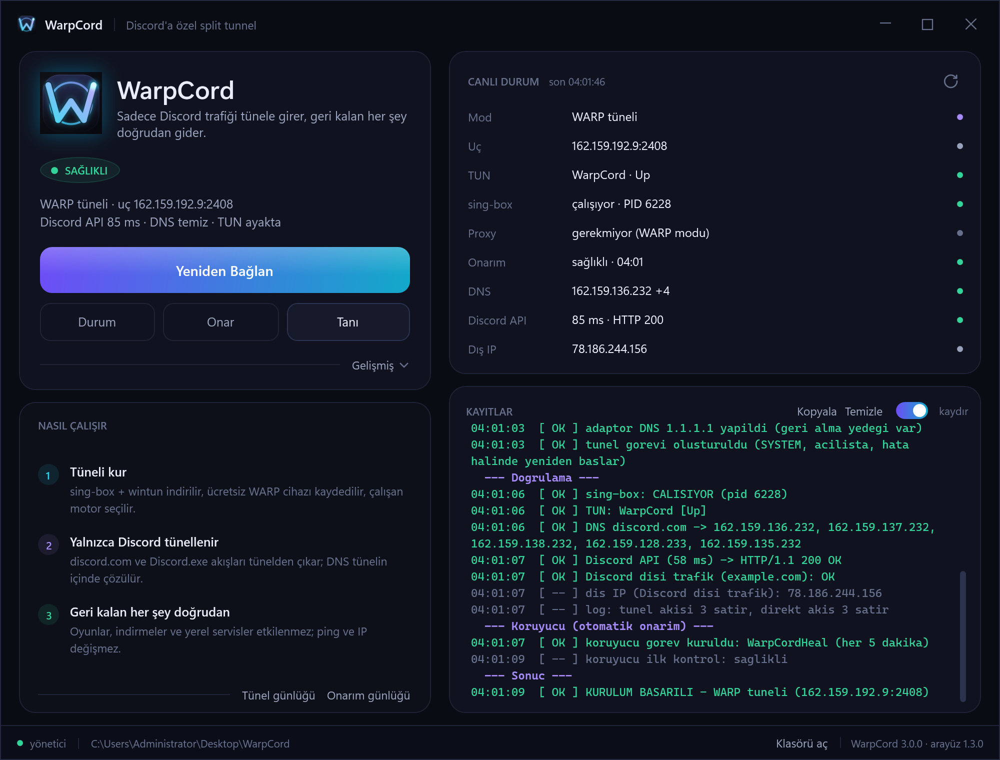
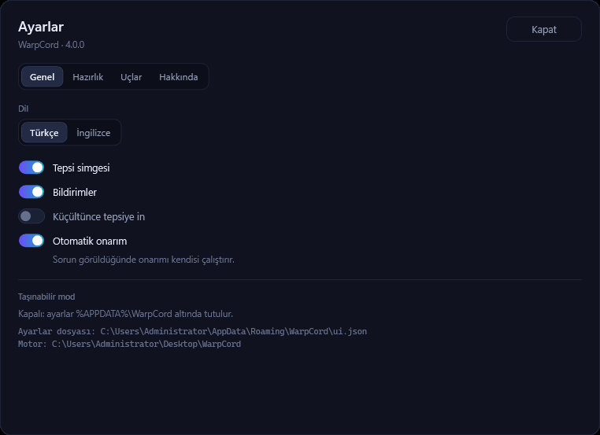
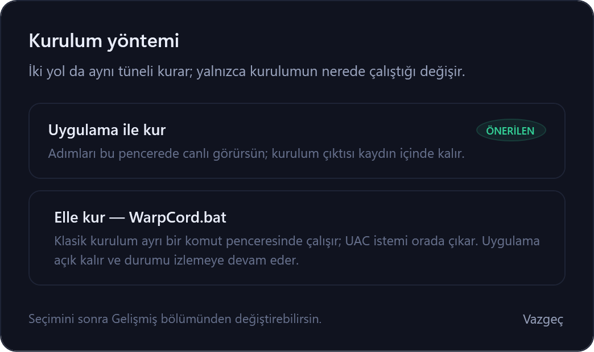

Türkçe | **[English](README.md)** &nbsp; [](https://github.com/Edipcm-hash/warpcord/actions/workflows/build.yml)

# WarpCord

Discord'a özel split tunnel: **yalnızca Discord trafiği** tünelden çıkar, geri kalan her şey doğrudan gider. VPS yok, hesap yok, tüm cihazı VPN'e sokmak yok.

Windows 10/11 (64-bit), yönetici hakkı ve internet yeterli. **Python ve .NET SDK gerekmez.**

## Hızlı başlangıç

1. Arşivi bir klasöre çıkar (Masaüstü olabilir).
2. **`WarpCord.bat`** dosyasına çift tıkla, UAC'ı onayla. (İstersen `dist\WarpCord.exe` ile aynı işi tek pencereden yap.)
3. Bekle: sing-box + `wintun.dll` indirilir, ücretsiz bir WARP cihazı kaydedilir, uçlar denenir, çalışan motor seçilir.
4. Discord'u tamamen kapat (tepsi simgesi dahil) ve yeniden aç.

| Kontrol | Onarım | Kaldırma | Teşhis |
|---|---|---|---|
| `durum.bat` | `onar.bat` | `kaldir.bat` | `tani.bat` |

## Masaüstü uygulaması

`dist\WarpCord.exe` — tek dosya (~541 KB), motoru içinde taşır; kurulum, onarım ve durum tek pencereden.



- **Canlı durum:** mod, uç, TUN, süreçler, son onarım, DNS, Discord API gecikmesi (mini grafik), dış IP.
- **Tek düğme:** kurulu değilse *Kur ve Bağlan*, sorun varsa *Onar*, sağlıklıysa *Yeniden Bağlan*.
- **Tepsi simgesi:** durum rengi + tünel düşünce bildirim; küçültünce tepsiye iner.
- **Günlük sekmeleri:** İşlem / Tünel (`tunnel.log`) / Onarım (`heal.log`) — canlı akar.
- **Ayarlar penceresi:** dil (Türkçe/İngilizce), tepsi ve bildirimler, otomatik onarım, **Hazırlık** denetimi (SAC/WDAC/Defender/politika), **Uçlar** karşılaştırması, sürüm denetimi ve tanı paketi.
- **Discord'u yeniden başlat** (durum çubuğu): kurulumdan sonra gereken "tamamen kapat, aç" adımı tek tık.
- **Ağ değişti uyarısı:** Wi-Fi → kablo geçişinde DNS'i yenilemeyi önerir.
- **Yönetici:** arayüz yöneticisiz açılır, işlem için UAC ile yükselir.
- **Tek başına:** `WarpCord.exe`'yi tek başına kopyalasan da çalışır; motoru ilk açılışta `%LOCALAPPDATA%\WarpCord\engine\<sürüm>\` altına açar. `portable.txt` koyarsan ayarlar ve motor exe'nin yanında kalır.



Dil seçimi: sağ üstteki **dişli → Ayarlar → Dil** (Türkçe / İngilizce). Seçim anında uygulanır ve hatırlanır — [görünüm](docs/ui-language.png).

### İki kurulum yolu

Kurulu değilken uygulama ilk açılışta bir kez sorar ve hatırlar; sonradan **Gelişmiş → Kurulum yöntemi**'nden değiştirilir:



- **Uygulama ile:** kurulum bu pencerede çalışır, adımlar canlı akar.
- **Elle (WarpCord.bat):** klasik kurulum ayrı bir yönetici komut penceresinde açılır; arayüz durumu izlemeye devam eder.

Arayüzü hiç açmayanlar için klasik yol her zaman duruyor: `WarpCord.bat`, `durum.bat`, `onar.bat`, `kaldir.bat`, `tani.bat`.

### Derleme

Windows ile gelen C# derleyicisi yeterlidir (imzalama ve SAC notları: [docs/SIGNING.md](docs/SIGNING.md)):

```bat
gui\build.ps1                    :: dist\WarpCord.exe
gui\build.ps1 -Shortcut -Smoke   :: masaüstü kısayolu + duman testi
```

Diğer durumlar: [sorun var](docs/ui-broken.png) · [kurulu değil](docs/ui-empty.png) · [DPI motoru](docs/ui-dpi.png) · [gelişmiş panel](docs/ui-advanced.png) · [elle kurulum](docs/ui-manual.png) · [tek dosya](docs/ui-standalone.png) · [SAC uyarısı](docs/ui-sac.png) · [İngilizce arayüz](docs/ui-en.png)

## İki motor

Discord Türkiye'de DNS zehirlenmesi + SNI filtresiyle engelli. WarpCord iki yolu da bilir ve çalışanı seçer:

| Mod | Ne zaman | IP gizlenir | Ses |
|---|---|---|---|
| `warp` | Cloudflare WARP hattı çalışıyorsa | Evet | Evet (UDP tünellenir) |
| `dpi` | WARP engelliyse (Superonline) | Hayır | Genelde evet |

`dpi` modu TLS ClientHello'yu birden çok TLS kaydına böler (RFC 8446 buna izin verir); DPI "discord.com"u tek kayıtta göremez. Sürücü gerekmez, yalnızca Discord'a kapsanır — GoodbyeDPI/zapret'in tek dosyalık hâli.

## Nasıl çalışır

```
Discord.exe, *.discord.com → TUN (WarpCord) → sing-box → warp | frag | direct
```

- **sing-box** bir TUN cihazı açar; alan adı Discord'a ait **veya** süreç Discord ise trafik tünele/proxy'ye, geri kalanı `direct`'e gider.
- **DNS** sing-box içinde DoH (1.1.1.1) ile çözülür; ISP'nin zehirli cevabı Windows'a ulaşmaz.
- `warp` çıkışı ücretsiz bir WARP cihazıdır; `dpi` çıkışı `127.0.0.1:1081`'deki yerel proxy'dir.

## Uyumluluk

| Ortam | Durum |
|---|---|
| Windows 10 (1809+) / 11, 64-bit | ✅ |
| Windows 11 ARM64 | ✅ |
| Ethernet, Wi-Fi, hotspot, router arkasında PPPoE | ✅ |
| IPv6 kapalı | ⚠️ WARP modu çalışmaz → otomatik DPI (IP gizlenmez) |
| Başka bir VPN açık | ⚠️ çakışır, kapatın |
| 32-bit Windows, Windows 7 / 8.1 | ❌ |
| Yönetici olmayan kullanıcı | ❌ (UAC gerekir) |

Ağ değiştirirseniz (Wi-Fi → kablo) Discord açılmazsa `WarpCord.bat`'ı tekrar çalıştırın: yeni adaptörü de yedekleyip DNS'i düzeltir.

## Komut satırı

```bat
WarpCord.bat                        :: otomatik: dene, çalışan modu seç
WarpCord.bat -Mode warp|dpi         :: modu zorla
WarpCord.bat -Force                 :: yeni ücretsiz WARP cihazı kaydet
WarpCord.bat -Endpoint IP:PORT      :: ucu elle sabitle
WarpCord.bat -KeepDns               :: sistem DNS'ine dokunma
durum.bat [-Restart|-Repair]        :: sağlık kontrolü / görevleri başlat / onar
onar.bat  |  tani.bat [-Bundle]  |  kaldir.bat
WarpCord.exe --smoke | --exec status|heal|install|diagnose|uninstall|manual
```

## Sık sorulanlar

**Superonline'da çalışır mı?** Evet: WARP engelliyse otomatik DPI motoruna geçer.

**Bu bir VPN mi?** Hayır. Yalnızca Discord akışları tünele girer; diğer trafikte IP'n ve rotan değişmez.

**DNS'imi değiştirir mi?** Sadece ISP DNS'i zehirliyorsa adaptör `1.1.1.1`e alınır (yedeklenir); temizse dokunulmaz.

**Ses çalışıyor mu?** WARP modunda evet. DPI modunda ses UDP'si doğrudan gider; ISP ayrıca engellemiyorsa çalışır.

**Bozulursa?** Koruyucu 5 dakikada bir onarır; hemen müdahale için `onar.bat`, olmazsa `kaldir.bat`.

**Akıllı Uygulama Denetimi (SAC) engelliyor?** İmzasız ikiliyi hiç çalıştırmaz ve izin listesi yoktur; aynı nedenle `sing-box.exe` de çalışmaz. Kapatın: **Ayarlar → Gizlilik ve güvenlik → Windows Güvenliği → Uygulama ve tarayıcı denetimi → Akıllı Uygulama Denetimi → Kapalı** (geri alınamaz). Çok makineye dağıtıyorsanız kalıcı çözüm imzalamaktır: `gui\build.ps1 -Certificate <parmak izi|.pfx>`. Durum: `Get-ItemProperty 'HKLM:\SYSTEM\CurrentControlSet\Control\CI\Policy' -Name VerifiedAndReputablePolicyState` → `0` kapalı, `1` açık, `2` değerlendirme.

**Antivirüs uyarısı?** TUN sürücüsü ve yönetici hakkı ister; `wintun.dll` resmî ve imzalıdır, derlenen `warp-frag.exe` imzasızdır.

**Config'te özel anahtar var mı?** Evet (`config.json`, `account.json`). Paylaşma, repoya koyma.

**Ne kadar hızlı?** WARP modunda 20–100 Mbps; DPI modu ~1–5 ms gecikme ekler.

## Dosyalar

| Dosya | Görev |
|---|---|
| `WarpCord.bat` | Tek tık: kur, onar, mod seç (UAC, MOTW temizliği, GPO fallback) |
| `dist\WarpCord.exe` | Masaüstü uygulaması — tek dosya, motoru içinde |
| `gui/` | Arayüz kaynağı (`src/*.xaml`, `src/*.cs`, `assets/`, `build.ps1`) |
| `app/install.ps1` | Kurulum: indir, kaydet, uç seç, kur, doğrula |
| `durum.bat` / `app/status.ps1` | Canlı sağlık kontrolü |
| `onar.bat` / `tools/warpheal.ps1` | Koruyucu: 5 dakikada bir denetle, onar, `heal.log`'a yaz |
| `tani.bat` / `tools/tani.ps1` | Teşhis raporu (`-Bundle` ile zip) |
| `kaldir.bat` / `app/uninstall.ps1` | Her şeyi sil, DNS ve istisnaları geri al |
| `tools/warpcore.ps1` | Motor: X25519 kayıt, uç seçimi, config, DNS |
| `tools/warpfrag/WarpFrag.cs` | DPI motoru: TLS kayıt parçalayan yerel proxy |
| `tools/sac-check.bat` | Smart App Control ön kontrolü |
| `docs/`, `CHANGELOG.md` | Config şablonları, ekran görüntüleri, sürüm notları |

İlk çalıştırmada sing-box (~33 MB) ve `wintun.dll` indirilir. İndirme istemiyorsan `bin\sing-box.exe` ve `bin\wintun.dll` olarak koy; kurulum önce oraya bakar.

Kurulumun sisteme dokunduğu yerler: `C:\ProgramData\DiscordTunnel` (loglar), zamanlanmış görevler (`DiscordOnlyTunnel`, gerekirse `WarpCordFrag`, `WarpCordHeal`), güvenlik duvarı izinleri ve **yalnızca DNS zehirliyse** adaptör DNS'i.

## Sürümler

- **v2.0** — tek tık, Python'suz, uç otomatik seçimi, WARP engelliyse DPI motoru.
- **v2.5** — koruyucu: 5 dakikada bir denetler ve onarır.
- **v3.0** — temiz Windows 11'de tek tık: MOTW, GPO, Defender, SAC, WDAC engelleri + `tani.bat`.
- **Arayüz 4.0** — tepsi simgesi ve bildirimler, günlük sekmeleri, hazırlık/uç araçları, İngilizce arayüz, otomatik onarım, taşınabilir mod, tek dosya.

Ayrıntılı notlar: [CHANGELOG.md](CHANGELOG.md)

## Test notu

Windows 11 25H2'de (MOTW + `RemoteSigned`, sıfırdan kurulum) 18/18 kontrol geçti; resmî Windows 11 Pro imajıyla VMware testinde kurulum sorunsuz tamamlandı. Geliştirme hattında (TTNet) `discord.com` → `195.175.254.2` ve `SNI=discord.com` → reset doğrulandı; IPv6 kapalı olduğu için otomatik DPI moduna geçip Discord API'sine gerçek cevap aldı.

## Sorumluluk reddi

Kendi kullanımım için geliştirdim; kendi riskinle ve bulunduğun yerin yasalarına uygun kullan. Discord veya Cloudflare ile bağlantılı değildir; WARP ücretsiz bir Cloudflare servisidir, çalışma garantisi yoktur.

MIT lisanslı.
