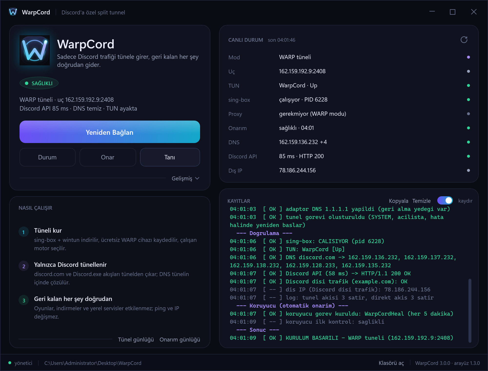
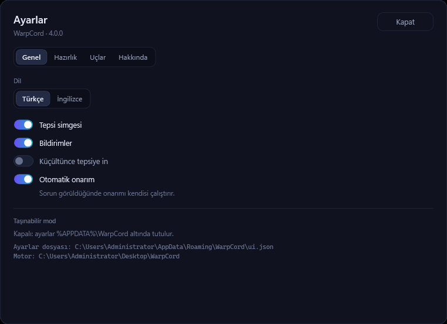

# WarpCord arayüzü — kullanıcı rehberi

Kısa yol: `dist\WarpCord.exe` (tek dosya) veya kuruluysa **Başlat → WarpCord**.
Yönetici hakkı yalnızca kurulum/onarım/kaldırma sırasında, UAC ile istenir.

## 1. Ana pencere

| Bölüm | Ne yapar |
|---|---|
| **Durum şeridi** (sol üst) | `SAĞLIKLI` / `SORUN VAR` / `KURULU DEĞİL`. Altındaki iki satır modu, ucu ve API gecikmesini özetler |
| **Tek düğme** | Kurulu değilse *Kur ve Bağlan*, sorun varsa *Onar*, sağlıklıysa *Yeniden Bağlan* |
| **Durum / Onar / Tanı** | `app/status.ps1`, `tools/warpheal.ps1`, `tools/tani.ps1` çalışır; çıktı günlük sekmesine akar |
| **Gelişmiş** | Motor (Otomatik/WARP/DPI), yeni WARP cihazı, DNS'e dokunmama, elle uç, ek süreçler, kurulum yöntemi, kaldırma |
| **Canlı durum** (sağ) | Mod, uç, TUN, süreçler, son onarım, Discord DNS, adaptör DNS'i, IPv6, API gecikmesi, ses (UDP), trafik, dış IP |
| **Günlük** (sağ alt) | İşlem / Tünel / Onarım sekmeleri, canlı |

Kısayollar: **F5** durumu yenile · **Ctrl+,** ayarlar.

## 2. Günlük sekmeleri

- **İşlem** — çalıştırdığın işlemlerin çıktısı (kurulum, onarım, tanı).
- **Tünel** — `tunnel.log` kuyruğu: Discord akışları `wireguard[warp]`/`http[frag]`, gerisi `outbound/direct`.
- **Onarım** — `heal.log`: koruyucunun her 5 dakikadaki kontrolü ve onarımları.

**Kopyala** panoya alır, **Temizle** boşaltır, sağdaki anahtar yeni satırlarda en alta kaydırır.

## 3. Ayarlar (dişli)

- **Genel**: dil (Türkçe/İngilizce), tepsi simgesi, bildirimler, küçültünce tepsiye in, otomatik onarım, taşınabilir mod bilgisi, **bu makineye kur / kaldır**.
- **Hazırlık**: SAC, WDAC/UMCI, Defender/ASR, CFA, politika, MOTW — kurulumu engelleyen bir şey var mı?
- **Uçlar**: WARP adaylarını Discord API'sine gerçek istekle dener; *en iyisini kullan* / *bu ucu kullan*.
- **Hakkında**: sürümler, imza durumu, sürüm denetimi (+ doğrulanmış indirme), tanı paketi.

## 4. Tepsi

Simge rengi durumu gösterir: yeşil sağlıklı, amber sorun, camgöbeği çalışıyor, gri kurulu değil.
Sağ tık: *WarpCord'u aç / Onar / Çıkış*. Çift tık pencereyi açar. Tünel düştüğünde bildirim gelir.

## 5. Kurulum yöntemi

İlk açılışta (kurulu değilken) bir kez sorulur:

- **Uygulama ile** — kurulum bu pencerede akar.
- **Elle (WarpCord.bat)** — klasik kurulum ayrı konsolda çalışır; pencere izlemeye devam eder.

Sonradan **Gelişmiş → Kurulum yöntemi**'nden değiştirilir.

## 6. Sorun giderme

| Belirti | İlk bakılacak |
|---|---|
| Uygulama hiç açılmıyor | Ayarlar → Hazırlık: **Smart App Control** açık mı? Açıksa Windows imzasız exe'yi çalıştırmaz (bkz. [SIGNING.md](SIGNING.md)) |
| "SORUN VAR" | Günlük → İşlem/Tünel; sonra **Onar** |
| Ses yok, yazı var | Canlı durum → **Ses (UDP)** "engelli" ise hat UDP'yi kapatıyor; WARP modu gerekir |
| DNS zehirli | Canlı durum → **DNS** kırmızıysa `Yeniden Bağlan` (adaptör 1.1.1.1'e alınır, yedeklenir) |
| Ağ değişti | Üstte çıkan şeritten **Yeniden Bağlan** |
| Discord açılmıyor | **Discord'u yeniden başlat** (durum çubuğu) |

Daha derin: `tani.bat` (veya Ayarlar → Hakkında → **Tanı paketi**), `heal.log`, `install.log`.
